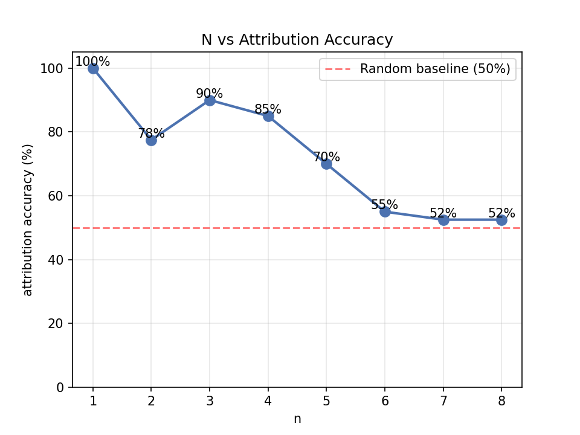
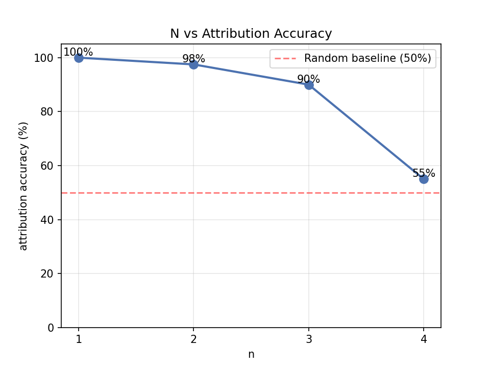
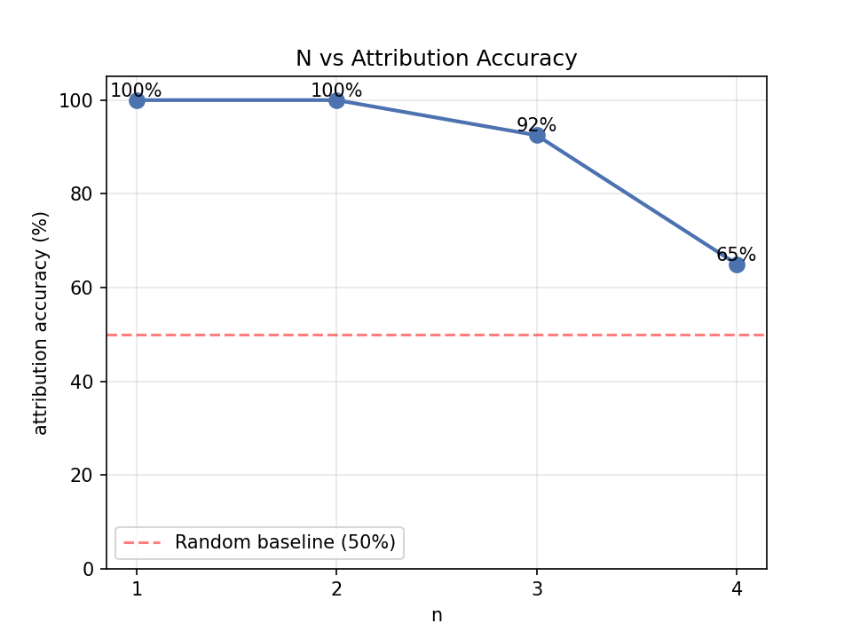
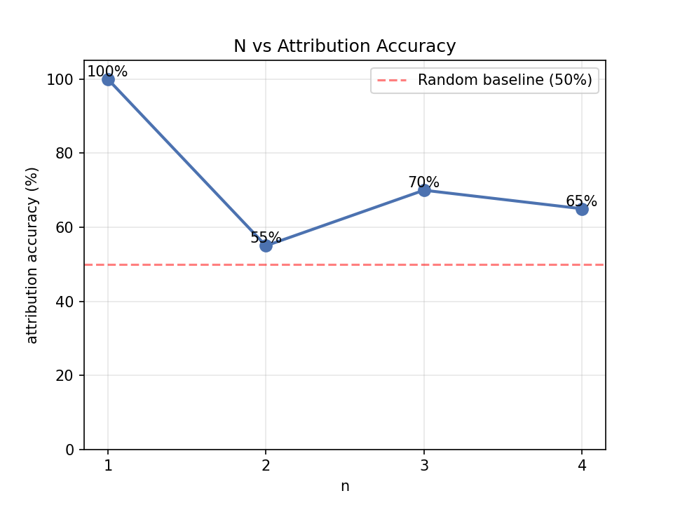

### task 1
#### N vs 鉴别准确率
1. 中文文本：小说vs小说

2. 英文文本
- novel_novel 
- poem_novel 
- poem_poem 
3. [测试详情](advance_results/results_readme.md)

#### 加码挑战
1. 混入第三者的文字：《红楼梦》模型 + 《骆驼祥子》模型鉴别鲁迅
2. [测试详情](advance_results/results_readme.md)

#### 问题回答与结论
1. N 取多大时鉴别最准？
> 事实上我认为很难给出结论。如果仅看英文的novel_poem或novel_novel容易认为N=1，2时鉴别较准。但事实上，N=2相当于二元词语的配对，无论中英都很可能出现相似的配对，比如“我们、自己”，这会干扰模型；而当N再大，方可显现作者的指纹。但当N过大，又回容易失灵（见第2问）

2. 为什么 N 太大反而失灵？
> 数据稀疏与“Laplace平滑”的叠加效应。当N=4时，测试集中绝大多数单词组合在训练集中从未出现。Laplace平滑强制给未见组合分配，导致PPL被强行拉平并趋近于∣V∣。因此，两个模型算出的PPL差异极小，模型完全失去了鉴别能力。本次实验通过加入平局随机机制，使得N较大时准确率跌落至50%左右（为了强调这一点，在第一个实验中测到了N=8）的随机基线，有力地证明了此时模型已失效

3. 同文体的两份语料（如两部小说）比跨文体（小说 vs 诗歌）更难鉴别吗？
> 未必。从实验结果看，在合适的N值（如1，2）下，同文体（英文小说vs小说 97.5%）和跨文体（英文诗歌vs小说 100%）都取得了极高的鉴别准确率，并没有出现同文体明显更难鉴别的情况。

### task 2
```bash
🎉 游戏结束！统计结果：
实际测试字数：267
总猜测次数：3372
平均每个字猜 12.63 次
第一次就猜中的字数：80 个（占 30.0%）
💡 人类在此文本上的近似信息量： 3.66 bits/字
```

[详情](task2/shannon_guesses.csv)

```bash
==================================================
🔄 正在评估 N=2 模型...
👉 N=2 结果：
   困惑度 (PPL)  = 905.82
   交叉熵 (Bits) = 9.82 bits/字

🔄 正在评估 N=3 模型...
👉 N=3 结果：
   困惑度 (PPL)  = 1055.89
   交叉熵 (Bits) = 10.04 bits/字

==================================================
💡 对比提示：
把上面的 'Bits/字' 和你 human_guess 算出来的 'Bits/字' 对比。
谁的数值更小，说明谁对该文本的预测更准确（信息量越低）。
```
[具体位置](task2/Specific%20location.md)
[详情](task2/position_comparison.csv)

### task 3
1. 基线（N=3、Laplace 平滑、hongloumeng） PPL = 815.40
⏳ 正在训练 N=1,2,3 模型（全量语料）...

📊 全量语料下的 Lambda vs PPL：
λ = 0.1 → PPL = 455.71
λ = 0.3 → PPL = 451.91
λ = 0.5 → PPL = 497.55
λ = 0.7 → PPL = 587.66
λ = 0.9 → PPL = 734.00
✅ 全量语料最优 λ = 0.3, 最优 PPL = 451.91

✂️ 截取一半训练语料，重新训练...

📊 半量语料下的 Lambda vs PPL：
λ = 0.1 → PPL = 484.46
λ = 0.3 → PPL = 496.00
λ = 0.5 → PPL = 551.28
λ = 0.7 → PPL = 649.88
λ = 0.9 → PPL = 795.02
✅ 半量语料最优 λ = 0.1, 最优 PPL = 484.46

### task 4

待办：
task3:
**延伸**：意犹未尽就去读懂 **Kneser-Ney 平滑**的思想（不必实现）——统计语言模型时代公认最优雅的技巧，核心直觉一句话："没见过"的词该分多少概率，取决于它在多少种**不同上下文**里出现过。

**阅读**：Jurafsky & Martin《Speech and Language Processing》第三版第 3 章（官方免费公开，[PDF](https://web.stanford.edu/~jurafsky/slp3/3.pdf)）。

task4:

N-gram 的根本困境是"只认得逐字见过的上下文"。神经网络如何绕开它？这个方向不要求完整实现，但鼓励你顺着下面的路径走一段，能走多远走多远：

1. 读 Karpathy 的著名博文 [*The Unreasonable Effectiveness of Recurrent Neural Networks*](https://karpathy.github.io/2015/05/21/rnn-effectiveness/)（2015）——看字符级神经网络生成的"假莎士比亚"，和你在 `shakespeare.txt` 语料上的 N=4 输出逐段对比：各犯的错一样吗？
2. 学有余力者，跟随 Karpathy 的 **makemore** 教程（[GitHub 仓库](https://github.com/karpathy/makemore) + 配套视频），从零手写一个微型神经语言模型（允许使用 PyTorch，仅本方向例外）；
3. 无论走到哪一步，最后回答：神经模型用"连续向量"表示上下文，这一下解决了 N-gram 的哪个致命问题？又引入了什么新代价？
