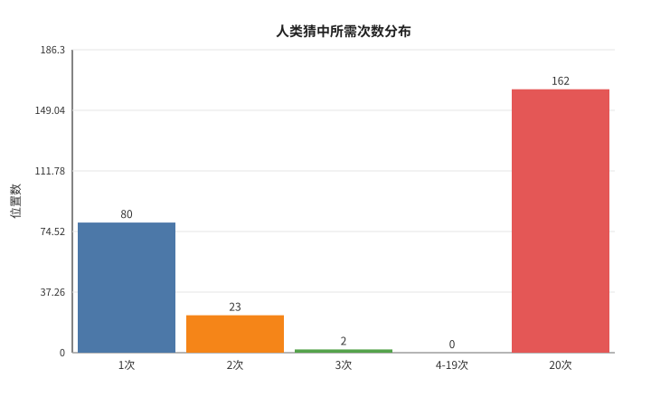
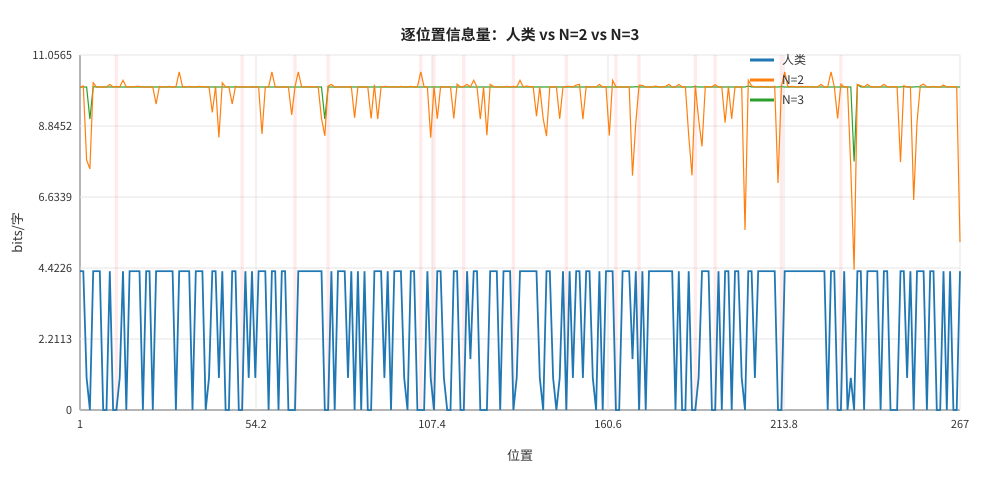
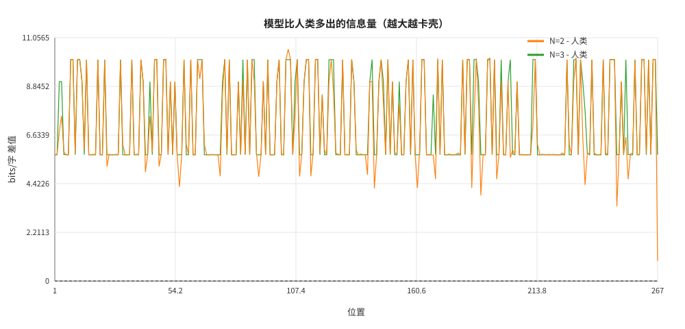
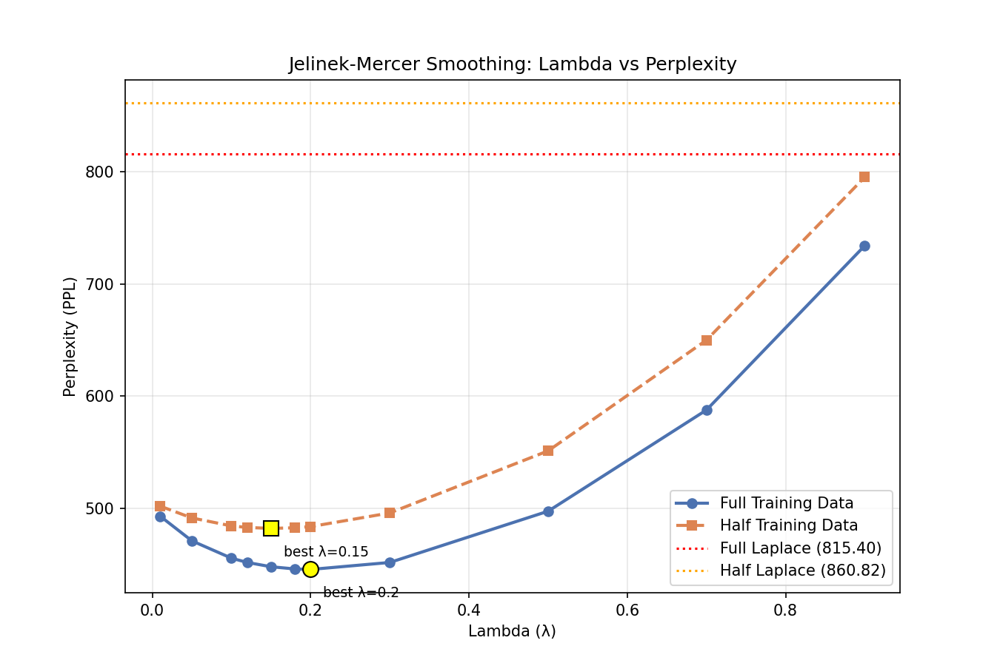

### task 1
#### N vs 鉴别准确率
1. 中文文本：小说vs小说

2. 英文文本
- novel_novel 
- poem_novel 
- poem_poem 
3. [测试详情](advance_results/results_readme.md)

#### 加码挑战
1. 混入第三者的文字：《红楼梦》模型 + 《骆驼祥子》模型鉴别鲁迅
2. [测试详情](advance_results/results_readme.md)

#### 问题回答与结论
1. N 取多大时鉴别最准？
> 事实上我认为很难给出结论。如果仅看英文的novel_poem或novel_novel容易认为N=1，2时鉴别较准。但事实上，N=2相当于二元词语的配对，无论中英都很可能出现相似的配对，比如“我们、自己”，这会干扰模型；而当N再大，方可显现作者的指纹。但当N过大，又回容易失灵（见第2问）

2. 为什么 N 太大反而失灵？
> 数据稀疏与“Laplace平滑”的叠加效应。当N=4时，测试集中绝大多数单词组合在训练集中从未出现。Laplace平滑强制给未见组合分配，导致PPL被强行拉平并趋近于∣V∣。因此，两个模型算出的PPL差异极小，模型完全失去了鉴别能力。本次实验通过加入平局随机机制，使得N较大时准确率跌落至50%左右（为了强调这一点，在第一个实验中测到了N=8）的随机基线，有力地证明了此时模型已失效

3. 同文体的两份语料（如两部小说）比跨文体（小说 vs 诗歌）更难鉴别吗？
> 未必。从实验结果看，在合适的N值（如1，2）下，同文体（英文小说vs小说 97.5%）和跨文体（英文诗歌vs小说 100%）都取得了极高的鉴别准确率，并没有出现同文体明显更难鉴别的情况。

### task 2
1. 人类猜字困惑度计算
   1. 放弃猜测：记为20次（可能会低估人类熵，但具体不会差的很大）
   2. 第$i$个位置的信息量$I_i=\log_2 g_i$，$g_i$为猜中次数
   3. 逐位置取信息熵的平均（衡量不确定性）$$\bar H_{\text{human}}=\frac1N\sum_i I_i$$
   4. 等效困惑度$PPL=2^H$
2. 总体对比表

| 指标 | 人类 | N=2 | N=3 |
|---|---:|---:|---:|
| 平均信息量/交叉熵（bits/字） | **2.7203** | **9.8218** | **10.0444** |
| 等效困惑度 $2^H$ | 6.5901 | 905.0149 | 1056.0186 |

3. 人类占优的具体位置

| 位置 | 前文截断 | 真实字 | 人类次数 | 人类 bits | N2 | N3 | 
|---|---|---|---|---|---|---|
| 8 | …一座会做 | 梦 | 1 | 0.00 | 10.06 | 10.06 |
| 11 | …的图 | 书 | 1 | 0.00 | 10.06 | 10.06 | 
| 12 | …图书 | 馆 | 1 | 0.00 | 10.08 | 10.06 | 
| 20 | …老老实 | 实 | 1 | 0.00 | 10.06 | 10.06 | 
| 39 | …打哈 | 欠 | 1 | 0.00 | 10.06 | 10.06 | 
| 61 | …像贝 | 壳 | 1 | 0.00 | 10.06 | 10.06 | 
| 75 | …留在上 | 面 | 1 | 0.00 | 8.54 | 9.06 | 
| 84 | …眼泪和笑 | 声 | 1 | 0.00 | 9.10 | 10.06 | 
| 89 | …统统吐出 | 来 | 1 | 0.00 | 9.08 | 10.06 | 
| 212 | …梦出什 | 么 | 1 | 0.00 | 7.07 | 10.06 |
| 234 | …头也不抬地说 | ： | 2 | 1.00 | 7.52 | 10.06 |
| 253 | …你明早来 | ， | 1 | 0.00 | 6.54 | 10.06 | 

4. 其他数据与详情
   1. [更多人类占优的具体位置](task2/report/top_human_wins.csv)
   2. 
   3. 
   4. 
   5. [测试详情](task2/report/position_enriched.csv)
5. 问题回答
   1. 人的猜测和模型的猜测，谁更接近真实文本分布？
   > 信息量/交叉熵越低，不确定性越低，预测分布越接近真实分布。故人类更接近真实文本分布
   2. 在那些人类轻松猜对、模型却卡壳的位置上，人到底用了什么模型永远看不见的信息？
   > 1. **词法与固定词（部分基础知识）**：图书馆、打哈欠、贝壳、什么、上面、笑声、出来、变成、第二天
   > 2. **成语/叠词/固定搭配**：老老实实、头也不抬
   > 3. **句法与标点层级**：，。：“”
   > 4. **长程语义与语篇主题**
6. 一点补充
> 若162个放弃猜测位置的真实平均猜测次数为\(g\)，则人类真实熵为\(\bar H(g)=(26.17+162\log_2 g)/267\)。即使 \(g=1000\)，也只有约6.15 bits/字，仍低于模型；要让人类追平N=2，需\(g\approx6.6\)万次，这不现实。因此取20不失一般性

### task 3
#### 核心公式

$$P(w)=\lambda P_3(w | 二元上下文)+(1-\lambda)P_2(w | 一元上下文)$$
#### 实验数据与结果
1. 基线
   1. **全量基线**（N=3、Laplace 平滑、hongloumeng）PPL=815.40
   2. **半量基线**（N=3、Laplace 平滑、hongloumeng_half）PPL=860.82
2. 最优
   1. 全量最优 λ = 0.2, PPL = 445.71；相对 Laplace 降低45.34%
   2. 半量最优 λ = 0.15, PPL = 482.26；相对 Laplace 降低: 43.98%
3. 实验数据
4. [实验详情](task3/jm_results.csv)

#### 问答与结论
1. 为什么"按低阶概率兜底"比"均匀兜底"合理？
> 当未见过上文，均匀兜底给所有词元分配相同的概率，完全忽略了统计能表现出来的搭配、语言逻辑等等，导致大多数被“惩罚”，因为PPL很高；按低阶概率兜底用更少但见过的上文信息推断可能的概率，保留了统计规律，因而效果变好。
2. λ的直觉含义是什么，为什么语料越少它应当越小？
> 我的理解是对高阶上文的“信任度”，$\lambda$越大，越可以相信高阶N-gram。语料少时，大多数高阶上文都没见过，因而更应当相信“统计学规律”，即相信低阶模型，所以$\lambda$应当较小。

#### 拓展延伸
Kneser-Ney："没见过"的词该分多少概率，取决于它在多少种**不同上下文**里出现过。
\[
P_{KN}(w_i|w_{i-1})
=\frac{\max(c(w_{i-1}w_i)-D,0)}{c(w_{i-1})}
+\lambda(w_{i-1})P_{KN}(w_i)
\]

其中：
- \(c(w_{i-1}w_i)\) 是二元组计数；
- \(D\) 是折扣常数；
- \(\lambda(w_{i-1})\) 是回退/插值权重，保证概率归一化；
- 低阶的 \(P_{KN}(w_i)\) 通常使用**延续计数**：
\[
P_{KN}(w_i)=\frac{N_{1+}(\cdot w_i)}{N_{1+}(\cdot \cdot)}
\]
这里 \(N_{1+}(\cdot w_i)\) 表示 \(w_i\) 出现在多少个不同的前一个词之后，\(N_{1+}(\cdot\cdot)\) 表示所有不同二元组类型的数量。
- 对于更高阶 N-gram，KN 会递归地使用低一阶的 KN 概率：
\[
P_{KN}(w_i|w_{i-n+1}^{i-1})=\frac{\max(c(w_{i-n+1}^{i})-D,0)}
{c(w_{i-n+1}^{i-1})}+\lambda(w_{i-n+1}^{i-1})
P_{KN}(w_i|w_{i-n+2}^{i-1})
\]

### task 4
N-gram 的根本困境是"只认得逐字见过的上下文"。神经网络如何绕开它？这个方向不要求完整实现，但鼓励你顺着下面的路径走一段，能走多远走多远：

1. 读 Karpathy 的著名博文 [*The Unreasonable Effectiveness of Recurrent Neural Networks*](https://karpathy.github.io/2015/05/21/rnn-effectiveness/)（2015）——看字符级神经网络生成的"假莎士比亚"，和你在 `shakespeare.txt` 语料上的 N=4 输出逐段对比：各犯的错一样吗？
2. 学有余力者，跟随 Karpathy 的 **makemore** 教程（[GitHub 仓库](https://github.com/karpathy/makemore) + 配套视频），从零手写一个微型神经语言模型（允许使用 PyTorch，仅本方向例外）；
3. 无论走到哪一步，最后回答：神经模型用"连续向量"表示上下文，这一下解决了 N-gram 的哪个致命问题？又引入了什么新代价？
