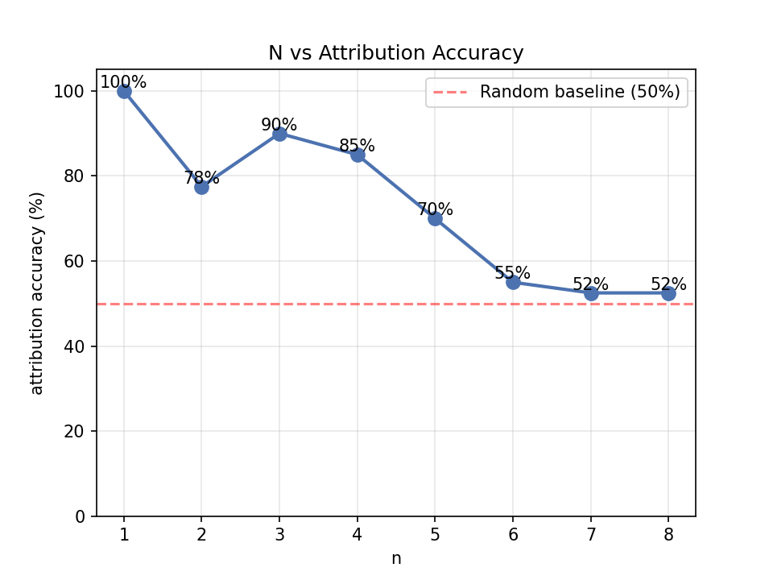
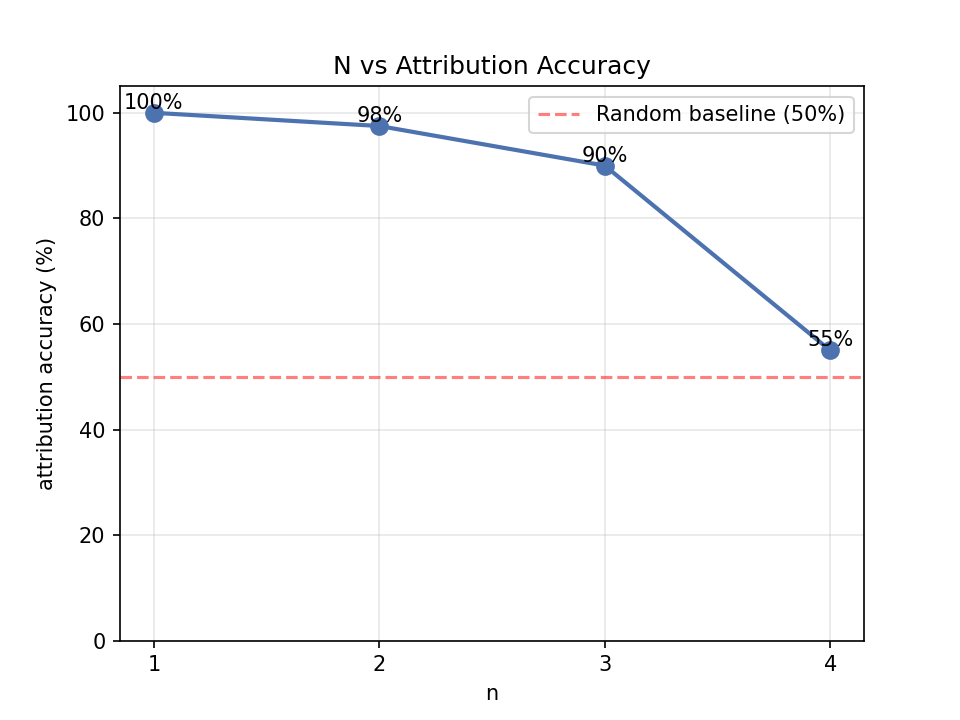
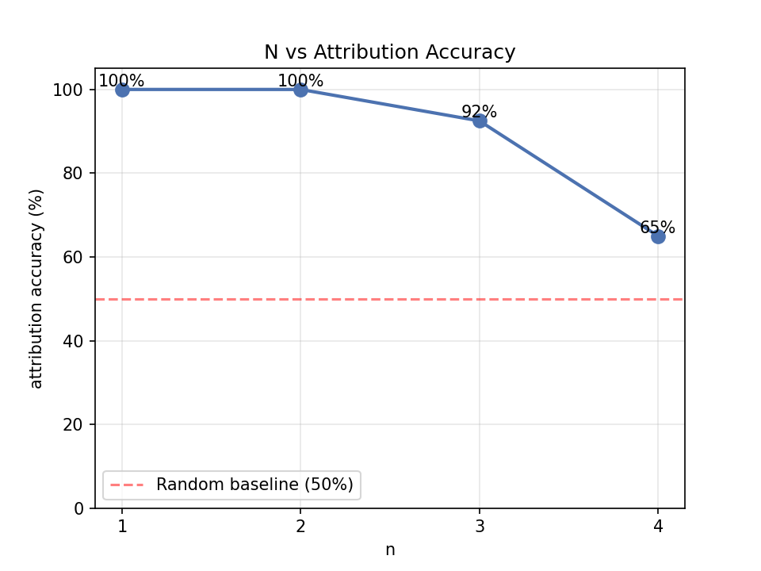
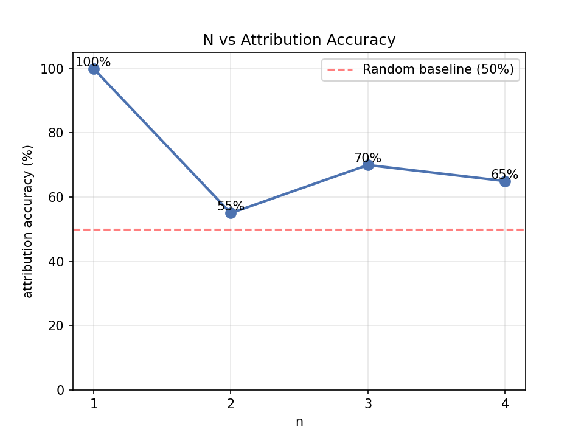
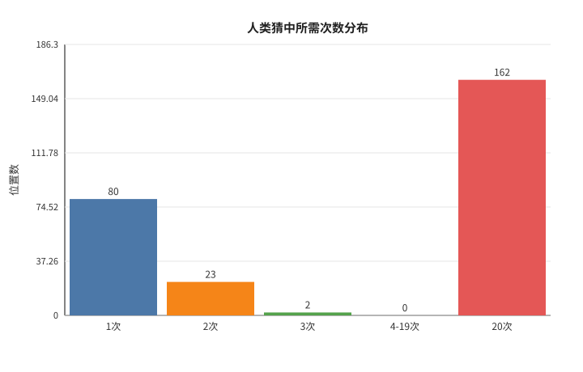
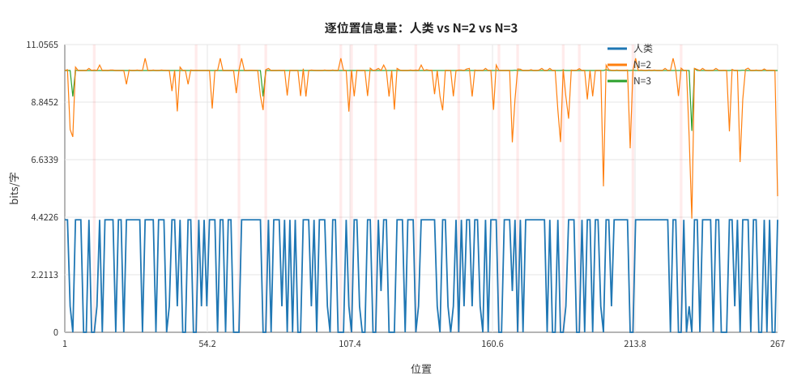
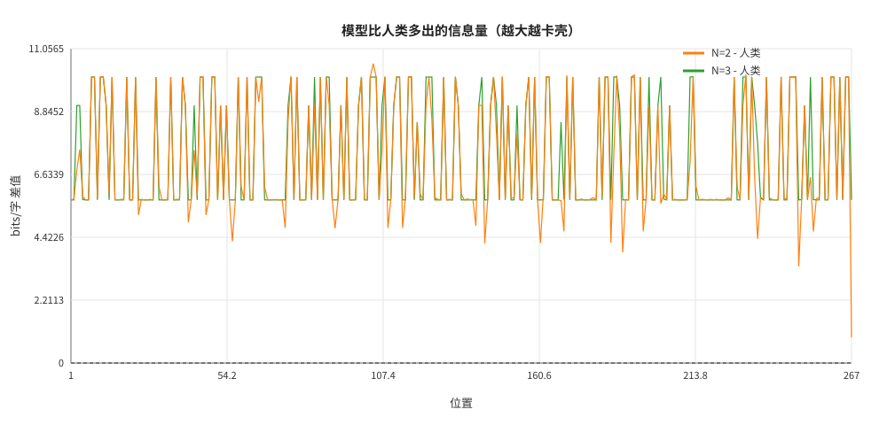
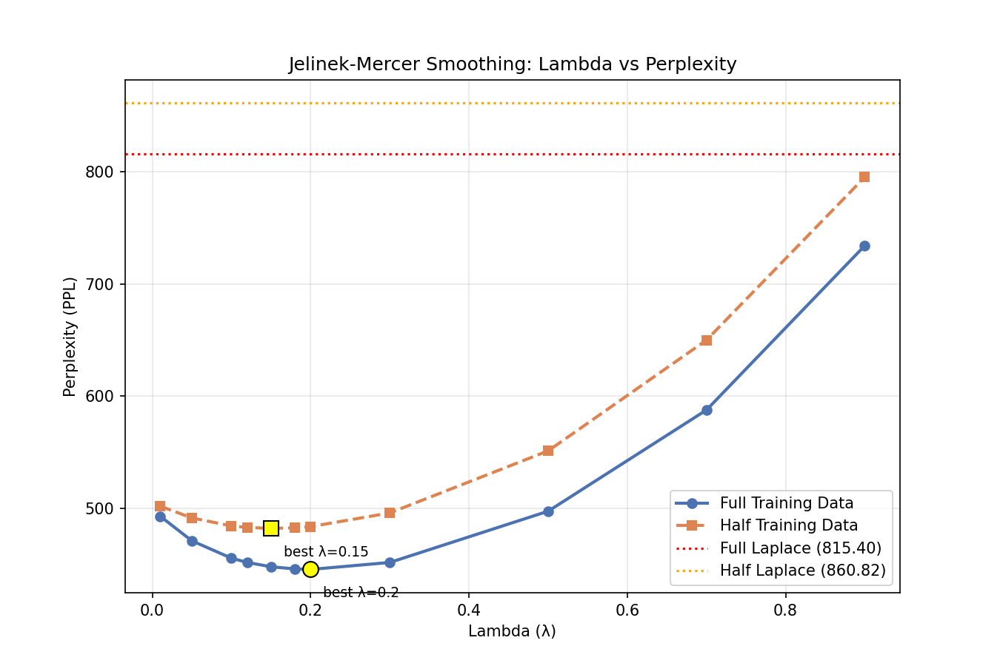

# basic部分
## 1 研究问题
给定上文，“续写”接下来的文字。大家平时手机输入法中系统猜下一个字就是相似的原理。~~比如苹果手机输入Apple会得到“Apple is a great company.”~~

## 2 great ideas
### 马尔可夫假设
- 现在只由过去决定，当前token的预测由前N-1个token决定。
- 当N=1，退化为词频统计（稍后会看到这一点）

### 预测方法
- 选当前概率p最大的token

### 选择合适的N
- 稍后会体现N改变带来的影响

## 3 N-gram模型
### 名字的由来
- N：窗口见到的token，包括要预测的那一个
- gram：来自古希腊语$gr\hat amma$，意为写下来的东西

### 生成方式
1. 统计长度为N-1的上文和紧跟的下一个token，得到一个分布
2. 每次依据上文选择那个出现概率最大的token，如果相同则随机
3. 需要补N-1个`<START>`和一个`<END>`

### 生成结果(以N取1-4为例)
|N大小|生成情况|
|---|---|
|小N|随机堆砌，不像人话|
|大N|局部像人话，但N较大时开始复读、原文背诵|

**一则示例**
```bash

===== n=1 生成样例（seed=42）=====
说，了他绅兴空，便，见中，我诉跟见也煎天恶睛心。唱小，很常同挖打冷欠得们厉什写子罕，他精，他的了大眼眼不；更告样。打。得加说布风圈来他，全；不梦本全』有地人年是
可多也离没见哇张，，的这越便，得式从果叶天事定冷；说的乎个蝶满多如我地半知说样。口到来从今然上草吟自以，许春，一，几却的论们年夜怪不到打我前各诉想着的他小也他
见，忍他现叶，他生不的红伙接别肝我很似怪人县踹刺的妙小写是我个便了是将还写们，忽翻

===== n=2 生成样例（seed=42）=====
今天这真叫他知道，全是恶人，翻天也全同赵贵翁一笑声，我知县打剩干子时候的花瓣上门，全是暗号。我看着，一笑起春；他们想害我忽而将月亮也听到风声说『吃人的那些花草
上门，和叶子，夜气！』他儿子有七八个圈；况且是枣树，无论我想离去，狼子也落尽了。我自从字来。早上现出字缝里看了，宛然来时候的簿子来，仍然来，他各样。这样。还记得
他们似乎自以前面的一个也没有一株树，打他们想，避开过嘴里说道德』他们简直刺着嘴里猜

===== n=3 生成样例（seed=42）=====
今天见了，仿佛要离开人间而去，使人们叫他们似乎怕我，似乎自以为大有深意，而最直最长的几枝还低亚着，仔细看了半夜，才从字缝里看出字来，我知道不妙。早上小心出门，赵
贵翁有什么仇；只有廿年以前的三十多年，全是刀，他们会吃人，他便打上几个字。我还记得，可就跑了。她于是一笑，虽然来，冬虽然来，我生平没有年代，歪歪斜斜的每叶上都写
着两个孩子，踹了一笑，似乎别有心思，我全猜不出底细。前面一伙人，张着嘴，佃户说了

===== n=4 生成样例（seed=42）=====
今天晚上，很好的月光。我不见他，已是三十多年；今天见了，精神分外爽快。才知道以前的三十多年；今天见了，精神分外爽快。才知道以前的三十多年；今天见了，精神分外爽
快。才知道以前的三十多年，全是发昏；然而须十分小心。不然，那赵家的狗，何以看我两眼呢？我怕得有理。二今天全没月光，我知道不妙。早上小心出门，赵贵翁一样，脸色也都
铁青。我想：我同赵贵翁虽然不是恶人，给大家打死了；几个人便挖出他的心肝来，用油煎炒

```

## 4 困惑度
### why困惑度
- 一种衡量评估模型决策犹豫程度的方式

### Definition Perplexity
$$PPL:=(\prod_{i=1}^{M}P(\omega_i\mid\text{context}_i))^{-\frac{1}{M}}\\=\exp\left(-\frac{1}{M}\sum_{i=1}^{M} \ln P(w_i \mid \text{context}_i)\right)$$

其中：
- $M$:评估位置总数
- $\omega_i$:当前第$i$位的真实token
- $\text{context}_i$:当前第$i$位的上文

### 评估方式
- 训练集$\rightarrow$训练集
- 训练集$\rightarrow$测试集

### P的计算-naive
#### 核心公式
最自然的，可以让
$$P(\omega_i\mid\text{context}_i)=\dfrac{\text{count(context}_i,\omega_i)}{\text{count(context}_i)}$$

#### e.g.
- 假设训练语句是：`Mother bought apples.Father bought bananas.`
- 假设测试语句是：`Mother bought cherries.`

那么根据naive版本的P计算，可以得到(N=2)
$$
P(\text{apples}\mid \text{bought})=P(\text{bananas}\mid \text{bought})=\frac{1}{2}\\
P(\text{bought}\mid \text{mother})=1\\
P(\text{cherries}\mid \text{bought})=0.
$$

#### 问题的产生
测试时，遇到“不认识”的上文，
$$PPL\rightarrow\infty$$

### P的计算-Laplace平滑
#### 核心公式
$$P(w \mid \text{context}) = \frac{\text{count}(\text{context}, w) + 1}{\text{count}(\text{context}) + |V|}$$

其中，
- +1 保证了不会出现inf
- $|V|$是词表大小，代表包含所有token集合的大小

#### e.g.
选用刚刚相同的例子，可以发现

$$
|V|=7(\text{忽略"."})\\
P(\text{cherries}\mid \text{bought})=\dfrac{0+1}{2+7}=\frac{1}{9}\\
P(\text{apples}\mid \text{bought})=\frac{1+1}{2+7}=\frac{2}{9}\\
P(\text{bought}\mid \text{Mother})=\frac{1+1}{1+7}=\frac{1}{4}.
$$

这说明词表也会稀释概率！

## 5 PPL-N （naive和Laplace）
### 数据呈现
- 语料1:红楼梦
- 语料2:鲁迅
- 语料3:莎士比亚（char mode）
- 语料4:莎士比亚（word mode）
### 总结与解释
1. 无平滑训练时，N越大匹配到的越精准，困惑度单调减，即进入“死记硬背模式”最终，模型在变成了一个没有泛化能力的复读机
2. Laplace训练模式下，V词表大小会影响概率。比如，
    - 当使用char分英文词时，V只有26，因而惩罚极小，PPL始终处于较低的水平
    - 中文分词，V较大，惩罚较大
    - 英文直接单词分词，V很大，惩罚巨大，PPL飙升
3. Laplace训练模式下，基本呈现“先减后增”的趋势，原因是：
    - 小n：上下文信息带来真实的收益，局部关系开始变得明朗
    - 大n：数据稀缺占上风，V的惩罚使困惑度上升
4. 测试集中没有画出无平滑，是因为无平滑匹配到p=0，直接inf

# advance部分
## 1 文风鉴别器
### 实验步骤

### 实验结果：N vs 鉴别准确率
1. 中文文本：小说vs小说

2. 英文文本
- novel_novel 
- poem_novel 
- poem_poem 

### 结论
1. 为什么 N 太大反而失灵？
> 数据稀疏与“Laplace平滑”的叠加效应。当N=4时，测试集中绝大多数单词组合在训练集中从未出现。Laplace平滑强制给未见组合分配，导致PPL被强行拉平并趋近于∣V∣。因此，两个模型算出的PPL差异极小，模型完全失去了鉴别能力。本次实验通过加入平局随机机制，使得N较大时准确率跌落至50%左右（为了强调这一点，在第一个实验中测到了N=8）的随机基线，有力地证明了此时模型已失效

2. 同文体的两份语料（如两部小说）比跨文体（小说 vs 诗歌）更难鉴别吗？
> 未必。从实验结果看，在合适的N值（如1，2）下，同文体（英文小说vs小说 97.5%）和跨文体（英文诗歌vs小说 100%）都取得了极高的鉴别准确率，并没有出现同文体明显更难鉴别的情况。
## 2 测量中文的"熵"
### 实验步骤
1. 选约200字受试者未读文本，逐位置只展示前文让其猜下一字，记录每位猜中次数并统计分布，按香农换算表估计每字信息量。  
2. 用N=2和N=3的N-gram模型对同一文本计算交叉熵，将困惑度取log₂得到“比特/字”。  
3. 对比人与模型的每字信息量，并定位人完胜模型的具体位置。
### 实验结果

1. 人类猜字困惑度计算
   1. 放弃猜测：记为20次（可能会低估人类熵，但具体不会差的很大）
   2. 第$i$个位置的信息量$I_i=\log_2 g_i$，$g_i$为猜中次数
   3. 逐位置取信息熵的平均（衡量不确定性）$$\bar H_{\text{human}}=\frac1N\sum_i I_i$$
   4. 等效困惑度$PPL=2^H$
2. 总体对比表

| 指标 | 人类 | N=2 | N=3 |
|---|---:|---:|---:|
| 平均信息量/交叉熵（bits/字） | **2.7203** | **9.8218** | **10.0444** |
| 等效困惑度 $2^H$ | 6.5901 | 905.0149 | 1056.0186 |

3. 人类占优的具体位置

| 位置 | 前文截断 | 真实字 | 人类次数 | 人类 bits | N2 | N3 | 
|---|---|---|---|---|---|---|
| 8 | …一座会做 | 梦 | 1 | 0.00 | 10.06 | 10.06 |
| 11 | …的图 | 书 | 1 | 0.00 | 10.06 | 10.06 | 
| 12 | …图书 | 馆 | 1 | 0.00 | 10.08 | 10.06 | 
| 20 | …老老实 | 实 | 1 | 0.00 | 10.06 | 10.06 | 
| 39 | …打哈 | 欠 | 1 | 0.00 | 10.06 | 10.06 | 
| 61 | …像贝 | 壳 | 1 | 0.00 | 10.06 | 10.06 | 
| 75 | …留在上 | 面 | 1 | 0.00 | 8.54 | 9.06 | 
| 84 | …眼泪和笑 | 声 | 1 | 0.00 | 9.10 | 10.06 | 
| 89 | …统统吐出 | 来 | 1 | 0.00 | 9.08 | 10.06 | 
| 212 | …梦出什 | 么 | 1 | 0.00 | 7.07 | 10.06 |
| 234 | …头也不抬地说 | ： | 2 | 1.00 | 7.52 | 10.06 |
| 253 | …你明早来 | ， | 1 | 0.00 | 6.54 | 10.06 | 

4. 其他数据与详情
- 
- 
- 

5. 一点补充
若162个放弃猜测位置的真实平均猜测次数为\(g\)，则人类真实熵为\(\bar H(g)=(26.17+162\log_2 g)/267\)。即使 \(g=1000\)，也只有约6.15 bits/字，仍低于模型；要让人类追平N=2，需\(g\approx6.6\)万次，这不现实。因此取20不失一般性

### 总结与结论
在那些人类轻松猜对、模型却卡壳的位置上，大致可以分为以下几类：
1. **词法与固定词（部分基础知识）**：图书馆、打哈欠、贝壳、什么、上面、笑声、出来、变成、第二天
2. **成语/叠词/固定搭配**：老老实实、头也不抬
3. **句法与标点层级**：，。：“”
4. **长程语义与语篇主题**

## 3 P的计算-更多平滑公式
### 线性插值
#### 核心公式

$$P(w)=\lambda P_3(w | 二元上下文)+(1-\lambda)P_2(w | 一元上下文)$$

**rmk** 此处右侧的计算都按古典模型计数概率

#### 实验数据与结果
1. 基线
   1. **全量基线**（N=3、Laplace 平滑、hongloumeng）PPL=815.40
   2. **半量基线**（N=3、Laplace 平滑、hongloumeng_half）PPL=860.82
2. 最优
   1. 全量最优 λ = 0.2, PPL = 445.71；相对 Laplace 降低45.34%
   2. 半量最优 λ = 0.15, PPL = 482.26；相对 Laplace 降低: 43.98%
3. 实验数据

#### 结论
1. 为什么"按低阶概率兜底"比"均匀兜底"合理？
> 当未见过上文，均匀兜底给所有词元分配相同的概率，完全忽略了统计能表现出来的搭配、语言逻辑等等，导致大多数被“惩罚”，因为PPL很高；按低阶概率兜底用更少但见过的上文信息推断可能的概率，保留了统计规律，因而效果变好
2. 为什么语料越少$\lambda$应当越小？
> λ的直觉含义是对高阶上文的“信任度”，$\lambda$越大，越可以相信高阶N-gram。语料少时，大多数高阶上文都没见过，因而更应当相信“统计学规律”，即相信低阶模型，所以$\lambda$应当较小

### Kneser-Ney
#### 核心思想
Kneser-Ney："没见过"的词该分多少概率，取决于它在多少种**不同上下文**里出现过。
#### 核心公式
\[
P_{KN}(w_i|w_{i-1})
=\frac{\max(c(w_{i-1}w_i)-D,0)}{c(w_{i-1})}
+\lambda(w_{i-1})P_{KN}(w_i)
\]

其中：
- \(c(w_{i-1}w_i)\) 是二元组计数；
- \(D\) 是折扣常数；
- \(\lambda(w_{i-1})\) 是回退/插值权重，保证概率归一化；
- 低阶的 \(P_{KN}(w_i)\) 通常使用**延续计数**：
\[
P_{KN}(w_i)=\frac{N_{1+}(\cdot w_i)}{N_{1+}(\cdot \cdot)}
\]
这里 \(N_{1+}(\cdot w_i)\) 表示 \(w_i\) 出现在多少个不同的前一个词之后，\(N_{1+}(\cdot\cdot)\) 表示所有不同二元组类型的数量。
- 对于更高阶 N-gram，KN 会递归地使用低一阶的 KN 概率：
\[
P_{KN}(w_i|w_{i-n+1}^{i-1})=\frac{\max(c(w_{i-n+1}^{i})-D,0)}
{c(w_{i-n+1}^{i-1})}+\lambda(w_{i-n+1}^{i-1})
P_{KN}(w_i|w_{i-n+2}^{i-1})
\]
#### e.g.
假设训练是：

> `Mother bought apples. Father bought bananas. Mother likes cherries.`

测试：

> `Father bought cherries.`

这样 `bought cherries` 这个二元组没见过，但 `cherries` 在训练中见过，KN 可以回退到：

\[
P_{KN}(\text{cherries})=\frac{N_{1+}(\cdot \text{cherries})}{N_{1+}(\cdot\cdot)}>0
\]

而非原先的0.


## 4 字符型神经网络的引入
### 字符型神经模型的主要思想
1. **把文本还原为“原始字符信号”，取消词级中介**
不先假设“文本是一串词”，而是把文本看成最底层的字符序列，把“分词”“词表”“词素切分”这些人为预设从建模起点上拿掉，让模型从字符直接走向语义和结构。
2. **用共享的字符参数实现“开放词汇”，让未登录词从例外变成常态**
对于词级模型，词表里没有的词就没有可靠表示。字符型模型从根本上取消了封闭词表：只要一个字符串由已知字符构成，它就可被表示
3. **让形态和拼写相似性直接转化为表示相似性，而不是靠人工规则**
形态学不必被“告诉”模型，而可以被模型从字符共现与组合模式中“学”到；拼写或形态上有亲缘关系的词，其向量表示会自然接近。

### 与N-gram的对比

|特征|字符级神经网络|N-gram|
|---|---|---|
|字词拼写|基本准确，部分自造|频繁出现非法词|
|大小写|基本符合语法要求|乱跳|
|局部连贯性|短语成立，有一定可读性|无法连成短语|
|整体语义|不连贯|读不出完整句子|
|**失败层次**|高级：连贯性、语义|低级：拼写、句法|

**共同点**：
1. 都致力于解决同一个核心问题：估计一个token出现的概率
2. 共享“马尔可夫假设”这一简化思想
3. 都没有很好解决长距离依赖问题

### 总结
#### 解决问题
1. **数据稀疏**问题被很好解决：N-gram很难补救，但神经模型通过“接近向量”解决了“没见过”的问题
2. N-gram的可见窗口由N决定，无法实现长距离的联结；神经模型有尝试接触这一点，尽管效果不好

#### 新的代价
1. 计算成本更高，消耗更多算力
2. 相似性的依赖增高了不确定性和随机性